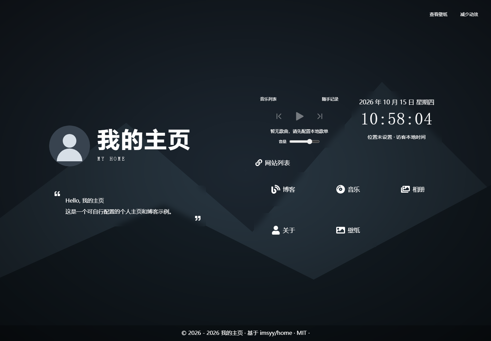
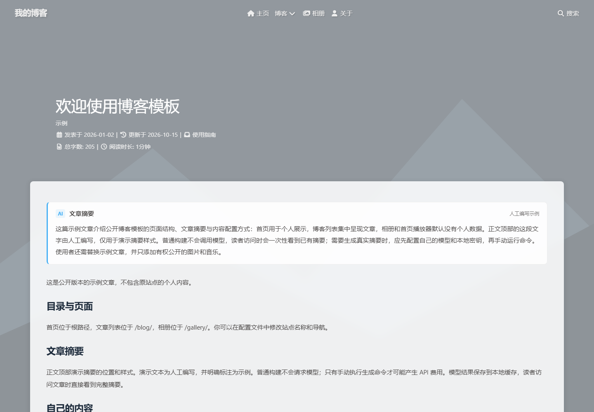

# Hexo + Butterfly 个人主页与博客模板

将 Vue 个人主页、Hexo 博客、相册和文章摘要放在同一个静态站点中。首页基于 [imsyy/home](https://github.com/imsyy/home) 改编，博客使用 [Butterfly](https://github.com/jerryc127/hexo-theme-butterfly)。

这是可自行配置的公开示例，已移除原站的个人资料、真实文章、照片、音乐、部署配置和运维历史。根路径部署是当前支持的方式；GitHub Pages 项目子路径尚未适配。

## 功能

- `/`：个人主页，站点导航、时钟、介绍与本地音乐播放器。
- `/blog/`：文章列表，轮播、竖向子菜单、归档、标签及关键词搜索。
- 文章正文顶部：读取构建前保存的摘要，访问时直接显示完整内容。
- `/gallery/`：相册入口及分类，添加照片后可使用拼贴视图与查看器。
- `/about/`：可替换的介绍页面。

默认歌单、相册为空。未包含独立音乐页、AI 聊天或知识库问答。评论和部署默认关闭。欢迎文章顶部的摘要明确标为“人工编写示例”，不是模型生成记录。

## 开始使用

使用 Node.js **24.x** 和 npm；两个锁文件分别管理 Hexo 与首页依赖。

```sh
git clone https://github.com/Stella-CaDo/hexo-butterfly-home.git
cd hexo-butterfly-home
```

```sh
npm ci
npm --prefix apps/homepage ci
npm run check:source
npm test
npm run build
npm run server
```

打开 `http://localhost:4000/`。停止预览按 Ctrl+C。`npm run server` 读取已生成的首页；修改首页 Vue 文件后需要重新执行 `npm run build`。只调试首页时，可运行 `npm --prefix apps/homepage run dev`，但歌单属于 Hexo 路径，完整联调应使用整站构建。

安装默认禁用依赖的安装脚本；构建和预览命令会显式运行有版本保护的兼容修复，针对 Butterfly 5.5.4 和 hexo-butterfly-swiper 1.0.12。升级依赖时先阅读 [修复说明](tools/hexo-compat/README.md)，否则构建可能因版本不符而停止。修复针对图片懒加载和轮播链接、脚本序列化，不修改生成的 HTML。

## 修改配置

| 文件 | 用途 |
| --- | --- |
| `_config.yml` | 标题、域名、文章列表、轮播与 Hexo 设置 |
| `_config.butterfly.yml` | 博客导航、头像、配色及主题设置 |
| `apps/homepage/profile.json` | 首页名称、介绍、位置、备案信息、导航和社交链接 |
| `apps/homepage/.env.example` | 首页标题、网页元信息与起始日期的示例 |
| `config/ai-summary.json` | 模型渠道、模型名、生成上限与超时 |
| `source/_posts/` | 示例文章，替换为你自己的内容 |
| `source/gallery/` | 相册页面和照片条目 |
| `source/music/playlist.json` | 同源音乐歌单，默认 `[]` |

博客与首页元信息是两套配置，请一并修改。需要覆盖首页元信息时，将 `.env.example` 复制为同目录下忽略提交的 `.env.local`；**任何 VITE_ 值都会进入网页，不要在这里放密钥**。本机部署信息放在根目录 `_config.local.yml`，参考 `_config.local.example.yml`。

默认 SVG 是随模板提供的中性占位图，可自行替换。未附带原站照片、字体、鼠标主题或社交图片。社交链接默认空；添加时填写 `name`、`url`、`tip`，默认显示名称文本。

修改站点域名或示例正文后，已有摘要会因 URL 或内容变化而隐藏，这是缓存失效保护。请生成自己的摘要，或删除示例缓存。

## 文章摘要

普通安装、测试和构建**不会调用模型**。摘要在构建前生成并保存，读者打开文章时看到静态完整摘要，不是实时流式生成。

当前客户端沿用 DeepSeek 的 JSON 输出和 `thinking: disabled` 参数。其他声称兼容 Chat Completions 的服务不一定支持全部参数，接入前需核对，必要时调整 `tools/ai-summary/model-client.cjs`。公开版本的验收使用模拟响应，没有用真实密钥调用模型。

1. 在 `config/ai-summary.json` 填写自己的 HTTPS OpenAI Chat Completions 兼容地址与真实可用的模型名。`configure-your-model` 是待替换值。
2. 复制根目录 `.env.ai.example` 为 `.env.ai.local`，在本机填写密钥；此文件已忽略提交。也可以使用进程环境变量。
3. 先运行只检查、不发送请求的命令：

```sh
npm run ai:summary:check
```

4. 确认文章范围与费用后，手动执行：

```sh
npm run ai:summary -- --post _posts/welcome.md
npm run build
```

手动生成会把选中文章正文发送给配置的模型服务，可能产生费用。`private`、`hidden`、`password`、`published: false`、`ai_summary: false` 等内容会被排除；仍请自行检查文章。请求失败最多尝试三次。修改、分段、模型参数变化会使缓存失效；不会截断过长文章。摘要缓存含文章信息，应与文章一起审阅后提交。

## 音乐和相册

添加方式见 [内容配置](docs/content.md)。仅放入你有权分发的媒体。音乐默认不自动播放，音频与歌词只使用同源路径。需要拖动进度时，静态服务器应支持 HTTP Range / 206；Hexo 的本地预览不能作为拖动验收依据。

## Git 与检查

```sh
git config core.hooksPath .githooks
npm run check:source
node tools/versioning/check-index.cjs
```

克隆不会自动启用本地 Git 钩子，需执行上述配置。索引检查用于发现误提交环境文件、常见密钥形式和超大文件，不保证识别所有敏感信息；提交前仍需检查差异。CI 独立执行检查、测试与构建，不部署、不配置模型密钥。

## 部署

先完成本地检查，再根据你的静态服务器填写配置。没有服务器地址或密钥的默认配置不会推送网站。

```sh
# 先构建；首页会同步到 source/index.html 和 source/home-assets/
npm run build
# 配置了自己的本机覆盖文件后，再重新生成并手动发布
npx hexo generate --config _config.yml,_config.local.yml
npx hexo deploy --config _config.yml,_config.local.yml
```

`public/` 是生成结果，不应提交到源码仓库；部署仓库与源码仓库可以分开。模板没有原站的音频排除部署钩子，也不依赖任何原服务器。发布媒体前评估流量、磁盘和权限。博客主题部分图标等资源沿用主题 CDN，首次加载需要网络；首页不调用第三方天气、语录、音乐 API。

## 许可与来源

自有代码和中性示例采用 [MIT](LICENSE)。第三方部分保留各自许可，详见 [THIRD_PARTY_NOTICES.md](THIRD_PARTY_NOTICES.md)，尤其相册所使用的 nanogallery2 为 GPLv3，不能把整个仓库统一标为只有 MIT。不要移除原作者声明。你后续加入的文章、图片、字体和音乐由你自行确定授权方式。

自动检查覆盖源码约束、摘要流程、首页工具函数及构建；浏览器、真实设备与真实媒体播放仍需在自己的部署环境验收。

## 预览

以下截图来自不含个人资料的公开示例。




